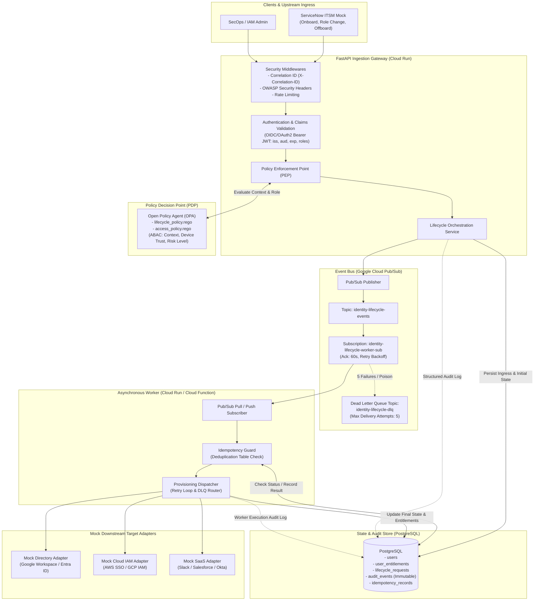

# Identity Lifecycle and Access Orchestration Platform

[](https://github.com/)
[](https://www.python.org/)
[](https://fastapi.tiangolo.com)
[](https://www.openpolicyagent.org/)
[](https://cloud.google.com/pubsub)
[](https://www.terraform.io/)
[](LICENSE)

> **PORTFOLIO DEMO NOTICE & SECURITY DISCLAIMER:**  
> This platform is an **architectural demonstration** built for portfolio evaluation and security design review.  
> It does **not** connect to live corporate identity providers, real customer directories, or production cloud accounts.  
> Downstream system provisioning (Google Workspace, AWS IAM, Slack) is executed via **mock adapters** with production-grade interfaces. Real keys, tokens, and credentials are intentionally excluded.

---

## Table of Contents
1. [Architecture Overview & Mermaid Diagram](#1-architecture-overview--mermaid-diagram)
2. [Recommended Repository Structure](#2-recommended-repository-structure)
3. [Key Security Controls & Engineering Choices](#3-key-security-controls--engineering-choices)
4. [Threat Model (STRIDE Matrix)](#4-threat-model-stride-matrix)
5. [Local Development & Quickstart](#5-local-development--quickstart)
   - [Option A: Standalone Zero-Dependency Run (Instant Local Dev)](#option-a-standalone-zero-dependency-run)
   - [Option B: Full Stack via Docker Compose](#option-b-full-stack-via-docker-compose)
6. [Automated Testing Suite](#6-automated-testing-suite)
7. [Terraform Infrastructure as Code (GCP)](#7-terraform-infrastructure-as-code-gcp)
8. [End-to-End Persona Demo Walkthrough](#8-end-to-end-persona-demo-walkthrough)
9. [Production Readiness Gap Analysis](#9-production-readiness-gap-analysis)
10. [Senior Security Engineer Interview Talking Points](#10-senior-security-engineer-interview-talking-points)

---

## 1. Architecture Overview & Mermaid Diagram

The platform decouples synchronous ingress validation from asynchronous target system provisioning using an event-driven, policy-governed architecture:



### Major Design Choices
1. **Decoupled Asynchronous Provisioning**: Downstream systems (e.g. AWS IAM, Google Workspace) often experience transient network latency, API rate limits, or intermittent downtime. Processing lifecycle requests synchronously within HTTP request loops causes timeouts, cascading failures, and poor user experience. Decoupling via Pub/Sub allows immediate acknowledgment of authorized requests while resilient workers perform retries and dead-letter routing in the background.
2. **Separation of Policy (PDP) from Enforcement (PEP)**: Access logic is externalized into Open Policy Agent (OPA) Rego rules. Application code never hardcodes role matrix rules; instead, it passes contextual telemetry (caller roles, device trust posture, risk score) to the Policy Decision Point.
3. **Idempotency by Design**: Cloud Pub/Sub guarantees *at-least-once* message delivery. Re-deliveries due to network partitions or worker restarts are handled cleanly by checking an atomic `idempotency_records` table in PostgreSQL before executing downstream side effects.

---

## 2. Recommended Repository Structure

```text
├── .github/
│   └── workflows/
│       └── ci.yml                 # GitHub Actions (Ruff, Pytest, OPA tests, Terraform validate)
├── docs/
│   └── openapi.json               # Exported OpenAPI 3.1 specification for Postman/Swagger
├── policies/                      # Open Policy Agent (OPA) Rego Rules
│   ├── lifecycle_policy.rego      # Onboard / Role Change / Offboard authorization rules
│   ├── lifecycle_policy_test.rego # Rego unit tests for lifecycle decisions
│   ├── access_policy.rego         # Context-aware ABAC authorization rules (device trust, risk)
│   └── access_policy_test.rego    # Rego unit tests for ABAC rules
├── scripts/
│   └── demo_e2e.py                # Automated end-to-end persona walkthrough demonstration
├── src/
│   ├── __init__.py
│   ├── main.py                    # FastAPI application initialization & security middleware
│   ├── adapters/                  # Downstream System Integration Layer (Mock SCIM / APIs)
│   │   ├── __init__.py
│   │   ├── base.py                # Abstract DownstreamSystemAdapter base class
│   │   ├── mock_directory.py      # Google Workspace / Microsoft Entra ID simulator
│   │   ├── mock_cloud.py          # AWS IAM Identity Center / GCP IAM simulator
│   │   └── mock_saas.py           # Slack / SaaS access simulator
│   ├── api/                       # REST API Routers
│   │   ├── __init__.py
│   │   ├── router.py              # Aggregated V1 API router
│   │   ├── health.py              # /healthz (liveness) and /readyz (readiness) probes
│   │   ├── auth.py                # /api/v1/auth (token minting and session inspection)
│   │   ├── lifecycle.py           # /api/v1/lifecycle (ServiceNow ingress webhook endpoints)
│   │   ├── policies.py            # /api/v1/policies (direct OPA authorization query)
│   │   ├── reviews.py             # /api/v1/reviews (periodic access review campaigns)
│   │   ├── anomalies.py           # /api/v1/anomalies (simulated security anomaly detection)
│   │   ├── audit.py               # /api/v1/audit (structured audit trail queries)
│   │   └── events.py              # /api/v1/events (Pub/Sub event and DLQ inspection)
│   ├── core/                      # Platform Foundations
│   │   ├── __init__.py
│   │   ├── config.py              # Pydantic v2 settings & environment validations
│   │   ├── security.py            # JWT verification (iss, aud, exp, signature, roles)
│   │   ├── logging.py             # Structured JSON logger & sensitive data scrubbing
│   │   ├── middleware.py          # Correlation ID, security headers, rate limiting
│   │   └── database.py            # Async SQLAlchemy session factory & SQLite/Postgres engine
│   ├── models/                    # SQLAlchemy ORM Database Schemas
│   │   ├── __init__.py
│   │   ├── identity.py            # User and UserEntitlement models
│   │   ├── lifecycle_request.py   # LifecycleRequest tracking model
│   │   ├── audit.py               # Immutable AuditEvent model
│   │   ├── idempotency.py         # IdempotencyRecord model
│   │   └── review.py              # AccessReviewCampaign and AccessReviewItem models
│   ├── schemas/                   # Pydantic Request & Response DTOs
│   │   ├── __init__.py
│   │   ├── auth.py
│   │   ├── lifecycle.py
│   │   ├── policy.py
│   │   ├── audit.py
│   │   ├── reviews.py
│   │   └── events.py
│   ├── services/                  # Business Logic Layer
│   │   ├── __init__.py
│   │   ├── policy_client.py       # OPA HTTP client with local PEP fallback evaluator
│   │   ├── pubsub_publisher.py    # GCP Pub/Sub publisher with emulator & queue fallback
│   │   ├── audit_service.py       # Immutable audit event writer
│   │   └── lifecycle_service.py   # End-to-end lifecycle orchestration coordinator
│   └── worker/                    # Asynchronous Event Processing
│       ├── __init__.py
│       ├── idempotency.py         # Worker idempotency deduplication guard
│       ├── processor.py           # Event processor with downstream adapter dispatch & DLQ
│       └── consumer.py            # Pull subscriber daemon & Cloud Run push router
├── terraform/                     # Google Cloud Platform Infrastructure as Code
│   ├── environments/
│   │   └── dev/                   # Dev environment root module
│   │       ├── main.tf
│   │       ├── variables.tf
│   │       ├── outputs.tf
│   │       └── terraform.tfvars.example
│   └── modules/
│       ├── pubsub/                # Pub/Sub topics, subscriptions, DLQ, exponential retry
│       ├── iam/                   # Least-privilege service accounts & scoped bindings
│       └── cloud_run/             # Serverless Cloud Run v2 services with health probes
├── docker-compose.yml             # Local multi-service environment (Postgres, OPA, PubSub)
├── Dockerfile                     # Multi-stage non-root container image
├── pyproject.toml                 # Ruff & Pytest configuration
├── requirements.txt               # Pinned dependencies
├── .env.example                   # Environment variable template
└── README.md                      # Comprehensive project documentation
```

---

## 3. Key Security Controls & Engineering Choices

### 1. OAuth2 / OIDC Token Verification
Implemented in [`src/core/security.py`](file:///c:/.net/ANew%20folder/Cyber%20Security%20Project/src/core/security.py):
* **Strict Claims Validation**: Every request requires a signed Bearer token and verifies `exp` (expiration), `iss` (trusted issuer), `aud` (audience), and `sub` (subject identity).
* **Role Verification**: Enforces mandatory `roles` claims (`hr_admin`, `identity_admin`, `security_engineer`, `contractor`).
* **Safe Error Envelopes**: Rejects tampered signatures, expired tokens, and wrong issuers with RFC-compliant HTTP 401 JSON envelopes without leaking stack traces.

### 2. Context-Aware Policy Decisions (ABAC via OPA)
Implemented in [`policies/lifecycle_policy.rego`](file:///c:/.net/ANew%20folder/Cyber%20Security%20Project/policies/lifecycle_policy.rego) and [`policies/access_policy.rego`](file:///c:/.net/ANew%20folder/Cyber%20Security%20Project/policies/access_policy.rego):
* Evaluates dynamic security posture before approving access:
  * **Device Trust Posture**: Requests from `untrusted` endpoints are barred from administrative and write operations.
  * **Risk Score Level**: High or critical risk scores block privileged role provisioning even if the caller has admin credentials.
  * **Perimeter Defense**: Explicit boundary rules ensure external contractors cannot access production cloud infrastructure or KMS keys.

### 3. Sensitive Data Scrubbing & Safe Logging
Implemented in [`src/core/logging.py`](file:///c:/.net/ANew%20folder/Cyber%20Security%20Project/src/core/logging.py):
* Prevents credentials and secrets from leaking into Cloud Logging or central SIEMs.
* Recursively strips sensitive dictionary keys (`password`, `token`, `secret`, `authorization`, `private_key`, `ssn`) and matches JWT token regex patterns, replacing them with `[REDACTED_SENSITIVE_DATA]`.
* Injects distributed `X-Correlation-ID` into every structured log event.

### 4. Idempotency & Dead Letter Queue (DLQ) Resilience
Implemented in [`src/worker/idempotency.py`](file:///c:/.net/ANew%20folder/Cyber%20Security%20Project/src/worker/idempotency.py) and [`src/worker/processor.py`](file:///c:/.net/ANew%20folder/Cyber%20Security%20Project/src/worker/processor.py):
* Pub/Sub redeliveries check atomic database records before mutating downstream targets. Duplicate message IDs are immediately identified and skipped without side effects.
* Downstream failures trigger exponential retry backoff. If max delivery attempts (5) are reached or a fatal error occurs, the message is routed to `identity-lifecycle-dlq` and an audit alert is logged.

### 5. Least-Privilege Terraform Infrastructure
Implemented in [`terraform/modules/iam/main.tf`](file:///c:/.net/ANew%20folder/Cyber%20Security%20Project/terraform/modules/iam/main.tf):
* **API Service Account**: Granted `roles/pubsub.publisher` exclusively on the lifecycle topic. Has no subscriber rights and cannot read from the topic.
* **Worker Service Account**: Granted `roles/pubsub.subscriber` on the worker subscription and `roles/pubsub.publisher` on the DLQ topic. Cannot publish to the main ingestion topic.

---

## 4. Threat Model (STRIDE Matrix)

| Threat Category | Threat Scenario | Platform Mitigation |
| :--- | :--- | :--- |
| **Spoofing** | Attacker calls lifecycle API impersonating HR or Admin | Cryptographic JWT signature verification (`HS256`/`RS256`), issuer & audience validation, and claims inspection. |
| **Tampering** | In-transit tampering of ServiceNow ticket roles | HMAC/RSA signature validation, schema validation with Pydantic v2, and SHA-256 payload logging. |
| **Repudiation** | An admin denies initiating a user termination or role change | Immutable `audit_events` table recording actor, action, timestamp, correlation ID, and IP address. |
| **Information Disclosure** | Token or PII leakage into log aggregator | Recursive log sanitizer scrubs tokens, passwords, and sensitive keys prior to JSON serialization. |
| **Denial of Service** | Flooding ingress endpoints with onboarding requests | `RateLimitMiddleware` (in-memory token bucket; Cloud Armor in production); async decoupling via Pub/Sub buffers load. |
| **Elevation of Privilege** | Standard employee attempts to assign themselves `cloud_admin` | Dual enforcement: FastAPI role guard rejects unauthorized callers; OPA PDP denies non-`identity_admin` role changes. |

---

## 5. Local Development & Quickstart

### Option A: Standalone Zero-Dependency Run
This project includes built-in mock fallbacks for OPA and Pub/Sub, as well as an async SQLite database engine (`aiosqlite`). You can run the entire platform locally without running Docker:

```bash
# 1. Activate the virtual environment
.\.venv\Scripts\Activate.ps1   # On Windows
# or source .venv/bin/activate  # On Linux/macOS

# 2. Run the FastAPI Server
python -m uvicorn src.main:app --host 127.0.0.1 --port 8000 --reload
```

Interactive API documentation will be available at:
* Swagger UI: [http://localhost:8000/docs](http://localhost:8000/docs)
* ReDoc: [http://localhost:8000/redoc](http://localhost:8000/redoc)

In another terminal, execute the automated end-to-end demo:
```bash
python scripts/demo_e2e.py
```

---

### Option B: Full Stack via Docker Compose
To run with PostgreSQL 16, Open Policy Agent server, and the official Google Cloud Pub/Sub Emulator:

```bash
# 1. Start all containers (Postgres, OPA, Pub/Sub Emulator, API, Worker)
docker compose up --build

# 2. Verify all services are healthy
docker compose ps

# 3. View live structured logs
docker compose logs -f api worker
```

Services exposed:
* **API Service**: `http://localhost:8000`
* **Open Policy Agent (OPA)**: `http://localhost:8181`
* **Google Cloud Pub/Sub Emulator**: `http://localhost:8085`
* **PostgreSQL Database**: `localhost:5432` (`identity_db`)

---

## 6. Automated Testing Suite

The project includes 23 automated tests covering token validation, OPA policies, worker idempotency, DLQ routing, and full API integration flows:

```bash
# Run all tests with coverage
pytest -v --cov=src tests/
```

### Test Suite Structure
* [`tests/unit/test_security.py`](file:///c:/.net/ANew%20folder/Cyber%20Security%20Project/tests/unit/test_security.py): Validates token expiry, tampered signatures, issuer validation, audience mismatch, and missing claims.
* [`tests/unit/test_policy_evaluator.py`](file:///c:/.net/ANew%20folder/Cyber%20Security%20Project/tests/unit/test_policy_evaluator.py): Tests context-aware authorization (contractor boundary, high risk rejection, unmanaged device blocks).
* [`tests/unit/test_worker_idempotency.py`](file:///c:/.net/ANew%20folder/Cyber%20Security%20Project/tests/unit/test_worker_idempotency.py): Verifies duplicate message deduplication and retry state transitions.
* [`tests/unit/test_worker_dlq.py`](file:///c:/.net/ANew%20folder/Cyber%20Security%20Project/tests/unit/test_worker_dlq.py): Verifies unhandled downstream exceptions route to the Dead-Letter Queue topic.
* [`tests/integration/test_api_endpoints.py`](file:///c:/.net/ANew%20folder/Cyber%20Security%20Project/tests/integration/test_api_endpoints.py): Tests `/healthz`, `/readyz`, `/api/v1/lifecycle`, `/api/v1/auth`, `/api/v1/reviews`, and `/api/v1/anomalies`.

---

## 7. Terraform Infrastructure as Code (GCP)

Terraform configurations are located in `terraform/environments/dev/` and utilize reusable modules:

```bash
cd terraform/environments/dev

# 1. Inspect example variables
cp terraform.tfvars.example terraform.tfvars

# 2. Initialize Terraform
terraform init -backend=false

# 3. Validate syntax and configuration
terraform validate

# 4. Preview deployment plan (dry-run)
terraform plan
```

### Module Overview
1. **`modules/pubsub`**: Provisions `identity-lifecycle-events` and `identity-lifecycle-dlq` topics with subscription retry policy (exponential backoff 10s–600s) and dead-letter policy (max 5 delivery attempts).
2. **`modules/iam`**: Implements least privilege by provisioning dedicated service accounts (`identity-api-sa` and `identity-worker-sa`) and scoping IAM bindings strictly to their required topics and subscriptions.
3. **`modules/cloud_run`**: Deploys Cloud Run v2 services for API and Worker with container health probes, resource limits, and environment variables.

---

## 8. End-to-End Persona Demo Walkthrough

The script [`scripts/demo_e2e.py`](file:///c:/.net/ANew%20folder/Cyber%20Security%20Project/scripts/demo_e2e.py) demonstrates realistic access management scenarios:

### Walkthrough Steps:
1. **Persona 1: Alice (HR Admin)**
   * Mints JWT with `roles=["hr_admin"]`.
   * Submits ServiceNow ticket to onboard Bob as a DevOps Engineer.
   * OPA verifies Alice's authority and context posture -> **APPROVED**.
   * Identity record created in PostgreSQL; lifecycle event published to Pub/Sub.
   * Worker simulates provisioning into Google Workspace, AWS IAM Identity Center, and Slack.

2. **Persona 2: Charlie (External Contractor)**
   * Mints JWT with `roles=["contractor"]`.
   * Attempts to request administrative access to production Cloud KMS keys.
   * OPA ABAC rule identifies contractor perimeter violation -> **DENIED**.
   * Security audit record logged with status `DENIED`.

3. **Persona 3: Eve (Compromised Credential / Impossible Travel)**
   * Simulates access from Tor Exit Node with `untrusted` device posture and `critical` risk level.
   * Anomaly detection flags session; access is blocked and high-severity security alert is recorded in audit logs.

4. **Persona 4: Dave (Departing Employee)**
   * Offboarding ticket submitted by SecOps admin.
   * Worker executes immediate revocation across Directory, Cloud IAM, and SaaS; user status set to `DEPROVISIONED`.

5. **Poison Message & DLQ**
   * Simulated downstream failure demonstrates retry thresholds and automatic routing to `identity-lifecycle-dlq`.

---

## 9. Production Readiness Gap Analysis

To adapt this architectural demo for enterprise production, the following items must be implemented:

| Component | Portfolio Demo Implementation | Production Enterprise Requirement |
| :--- | :--- | :--- |
| **Authentication (IdP)** | Local symmetric HMAC (`HS256`) demo keys | OIDC Discovery & JWKS endpoint validation against corporate IdP (Okta, Entra ID, PingIdentity) using asymmetric `RS256`/`ES256`. |
| **Secret Storage** | `.env` / environment variables | Google Cloud Secret Manager with automatic versioning, IAM access restrictions, and audit logging. |
| **Downstream Targets** | In-memory Mock Adapters | SCIM 2.0 client (`RFC 7644`), Google Workspace Directory API, AWS IAM Identity Center SCIM API. |
| **Database** | SQLite / Local PostgreSQL container | Google Cloud SQL (PostgreSQL) with private IP (Cloud SQL Auth Proxy), automated backups, and read replicas. |
| **Rate Limiting & DDoS**| In-memory sliding window middleware | Google Cloud Armor edge security policies applied to external Application Load Balancers. |
| **Distributed Tracing** | ContextVar `X-Correlation-ID` | OpenTelemetry SDK with Cloud Trace and Cloud Logging trace context propagation (`traceparent` header). |

---

## 10. Senior Security Engineer Interview Talking Points

* **Policy as Code (PaC) decoupled from Codebase**: Why did we use OPA Rego instead of Python `if/else` statements? Externalizing authorization logic allows security teams to audit, test, and update organizational access rules independently of application deployments.
* **At-Least-Once Delivery vs. Exactly-Once Processing**: Cloud Pub/Sub guarantees at-least-once delivery. Explain how the `IdempotencyRecord` table prevents duplicate downstream side-effects (e.g., duplicate account creations or email invitations) during message redeliveries.
* **Least Privilege IAM Architecture**: Highlight that the API gateway service account cannot read from the Pub/Sub topic, and the Worker service account cannot publish to the main ingestion bus—preventing cross-privilege escalation if one container is compromised.
* **Context-Aware Zero Trust Principles**: Access is never granted purely on role existence; dynamic context (device compliance, risk signals, geo-velocity) is continually factored into authorization decisions.
* **Defense in Depth**: Security headers (`CSP`, `HSTS`, `nosniff`), rate limiting, structured audit logging, sensitive data scrubbing, and non-root container sandboxing ensure multi-layered security.
